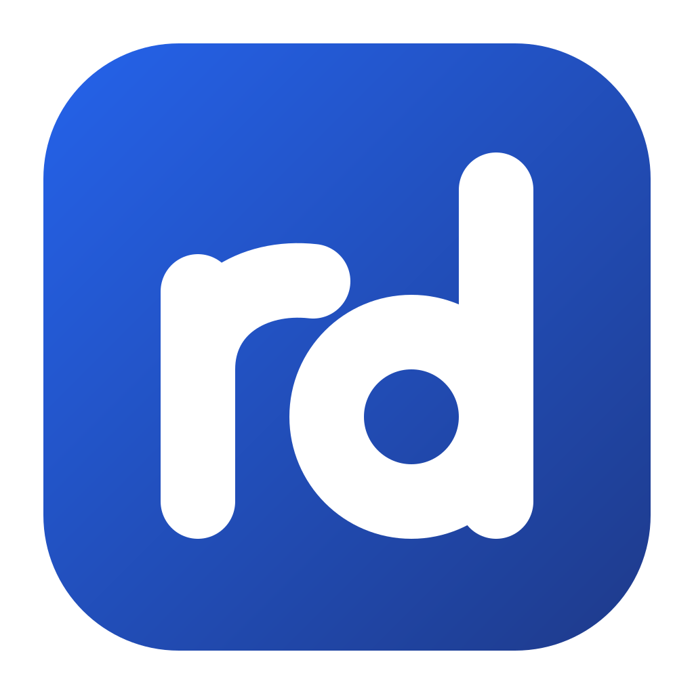

<div align="center">



# rd

**A low-latency remote desktop that runs in a plain browser tab.**

One WebSocket. Port 443. No client to install, no inbound ports at home.

[](https://github.com/Thijmen/remoted/actions/workflows/ci.yml)
[](https://github.com/Thijmen/remoted/actions/workflows/desktop.yml)
[](https://github.com/Thijmen/remoted/actions/workflows/gateway-image.yml)

</div>

---

## Why

Some machines can't run remote-desktop software. A locked-down work laptop may block
VNC, RDP, SSH and anything else that isn't a web browser talking HTTPS on port 80 or 443.

rd works within those limits. The Mac or Windows PC you want to reach dials **out** to a small
gateway, and you open the gateway in any modern browser. Screen, keyboard, mouse and audio all
travel over a single secure WebSocket, the same kind of traffic as any other web app.

## How it works

```
┌──────────────────────┐        ┌──────────────────────────┐        ┌──────────────────────┐
│  Browser             │  WSS   │  rd-gateway              │  WSS   │  rd-agent            │
│  (or rd Desktop)     │ ─────▶ │  Kubernetes, behind      │ ◀───── │  on the Mac or PC    │
│  WebCodecs decoding  │  :443  │  Traefik + Authentik     │  :443  │  dials out, always   │
└──────────────────────┘        └──────────────────────────┘        └──────────────────────┘
```

| Component | What it does |
|---|---|
| **rd-agent** | Captures the screen (ScreenCaptureKit on macOS, Desktop Duplication on Windows), encodes hardware H.264 (VideoToolbox; Media Foundation with NVENC, Quick Sync or AMF), streams Opus audio and injects mouse and keyboard input. It connects *out* to the gateway, so nothing listens at home. |
| **rd-gateway** | Serves the portal and the viewer, checks who you are (Authentik + an email allowlist), and joins the viewer and agent sockets without buffering. Ships as a small distroless image. |
| **viewer** | A TypeScript web app that decodes video with WebCodecs and acknowledges every frame. |
| **rd Desktop** | An optional Windows/macOS app that shows the same viewer in a window and also captures the shortcuts a browser never sees (Alt+Tab, Cmd+Tab, the Windows key, …). |

### Why it stays responsive

Most streaming tools fill a buffer when the network slows down, and the picture falls further
and further behind. rd works the other way around: the viewer acknowledges each frame, and
when the link can't keep up the agent **drops frames before encoding** and lowers the bitrate.
You may see fewer frames for a moment, but what you see is current.

## Features

- 🖥️ **Runs in a browser tab.** Any modern browser with WebCodecs. Nothing to install.
- 🔒 **Outbound only.** The agent dials out, so you open no ports on your home router.
- ⚡ **Low latency.** Hardware H.264, up to 60 or 120 fps, adaptive bitrate tuned in a network simulator.
- 🔊 **Audio** over Opus with an adaptive jitter buffer.
- ⌨️ **Keyboard that works.** Physical key codes, Caps Lock sync, automatic Windows ⇄ Mac modifier mapping (Ctrl ⇄ Cmd), and full shortcut capture with rd Desktop.
- 🖱️ **Multiple displays**, pointer lock and scaling that keeps the right aspect ratio.
- 👤 **Single sign-on** through Authentik, with an email allowlist and a separate token per agent.
- ➕ **Add device** in the portal: it gives you a one-time setup code to paste into the agent's setup.
- 📶 **Network probe.** A built-in test (`/probe`) checks whether your connection can carry a session, before you rely on it.
- 🖥️ **Mac and Windows hosts.** Reach a Windows PC from a Mac (Cmd acts as Ctrl) or a Mac from Windows.
- 🔄 **Updates itself.** rd Desktop and the agents find new versions, show what's new and install them when you say so; an agent update from the portal rolls back if the new version doesn't come back. See [updates](docs/updates.md).
- 🛟 **Recovery path.** Lock screen, login window or a reboot on the Mac? Apple Screen Sharing over Guacamole takes over. See [recovery](docs/recovery.md).

## Getting started

rd has three parts to set up. Each has its own guide:

1. **Run the gateway**: [docs/gateway.md](docs/gateway.md). The image is published as
   `ghcr.io/thijmen/rd-gateway`.
2. **Install the agent** on the machine you want to reach, at the machine itself:
   [docs/setup-mac.md](docs/setup-mac.md) (macOS asks a person to approve Screen Recording and
   Accessibility) or [docs/setup-windows.md](docs/setup-windows.md).
3. **Connect**: open your gateway (for example `https://rd.example.com`), sign in and pick
   your machine. Or install [rd Desktop](clients/desktop/README.md) from the
   [releases](https://github.com/Thijmen/remoted/releases).

To add another device later, click **Add device** in the portal; see [docs/devices.md](docs/devices.md).
After that, rd Desktop and the agents update themselves: [docs/updates.md](docs/updates.md).

### Try it locally

```sh
# build the viewer
cd viewer && bun install && bun run build && cd ..

# start the gateway with auth turned off, on localhost only
cargo run -p rd-gateway -- --dev --assets-dir viewer/dist
```

The portal is now at <http://127.0.0.1:8080>, and agents connect to `ws://127.0.0.1:8081`.
See [docs/setup-mac.md](docs/setup-mac.md#local-development-no-cluster-no-permissions) or
[docs/setup-windows.md](docs/setup-windows.md#local-development-no-cluster) for running an
agent against it.

## Documentation

| | |
|---|---|
| [docs/protocol.md](docs/protocol.md) | Wire protocol v1: the contract between all components |
| [docs/gateway.md](docs/gateway.md) | Gateway configuration and operation |
| [docs/setup-mac.md](docs/setup-mac.md) | Installing the Mac agent, local development |
| [docs/setup-windows.md](docs/setup-windows.md) | Installing the Windows agent, local development, limits |
| [docs/devices.md](docs/devices.md) | Adding, rotating and removing devices (machine ids, tokens) |
| [docs/updates.md](docs/updates.md) | How rd Desktop and the agents update, releases, signing keys |
| [docs/recovery.md](docs/recovery.md) | Recovery path (Screen Sharing / SSH via Guacamole) |
| [docs/desktop-client.md](docs/desktop-client.md) | rd Desktop design and the page ⇄ app bridge ([install, build](clients/desktop/README.md)) |

## Repository layout

```
crates/rd-proto            wire protocol (shared by agent and gateway), HID keymap
crates/rd-flow             flow control: in-flight window + delay-based bitrate controller
crates/rd-agent-core       agent runtime, selftest harness, test pattern (platform independent)
crates/rd-platform-macos   ScreenCaptureKit, VideoToolbox, CGEvent, IOKit, Keychain
crates/rd-platform-windows Desktop Duplication, D3D11 video processor, Media Foundation, SendInput
crates/rd-agent            the agent binary (run | setup | install | uninstall | status | selftest);
                           rd-agentw: the Windows background launcher
crates/rd-gateway          relay, portal, network probe; embeds viewer/dist
viewer/                    TypeScript viewer (Vite + Bun)
clients/desktop            rd Desktop (Tauri): the viewer in a window + keyboard grab (Windows, macOS); own Cargo.lock
tools/gen-keymap           Chromium key table -> Rust/TS keymaps
tools/release              changesets helper: rd Desktop version -> Cargo.toml/Cargo.lock
.changeset                 pending release notes (changesets)
packaging/macos            app bundle, signing, LaunchAgent
packaging/windows          rd-agent installer (NSIS, per user)
deploy/Dockerfile          gateway image (linux/arm64)
```

## Development

Run the same checks as CI before you push:

```sh
cargo fmt --all --check && cargo clippy --workspace --all-targets -- -D warnings && cargo test --workspace
(cd viewer && bun run typecheck && bun run test && bun run build)
bun tools/gen-keymap/gen.ts --check
```

## Releases

rd Desktop is released with [changesets](https://github.com/changesets/changesets): add one
with `bun changeset` in a PR, merge the generated *Version packages* PR to tag and publish.
See [clients/desktop/README.md](clients/desktop/README.md#releasing). The gateway image keeps
its own versioning (`gateway-v*`, on every push to main; `.github/workflows/gateway-image.yml`).

## Platform support

| | Status |
|---|---|
| Agent on macOS | ✅ Supported |
| Agent on Windows | ✅ Windows 10 (1703+) and 11 |
| Viewer in a browser | ✅ Any browser with WebCodecs, over HTTPS |
| rd Desktop | ✅ Windows 10/11 and macOS 12+ |

## Acknowledgements

The key code tables are generated from Chromium's DOM key code data (BSD-3-Clause).
See [THIRD_PARTY_NOTICES.md](THIRD_PARTY_NOTICES.md).
